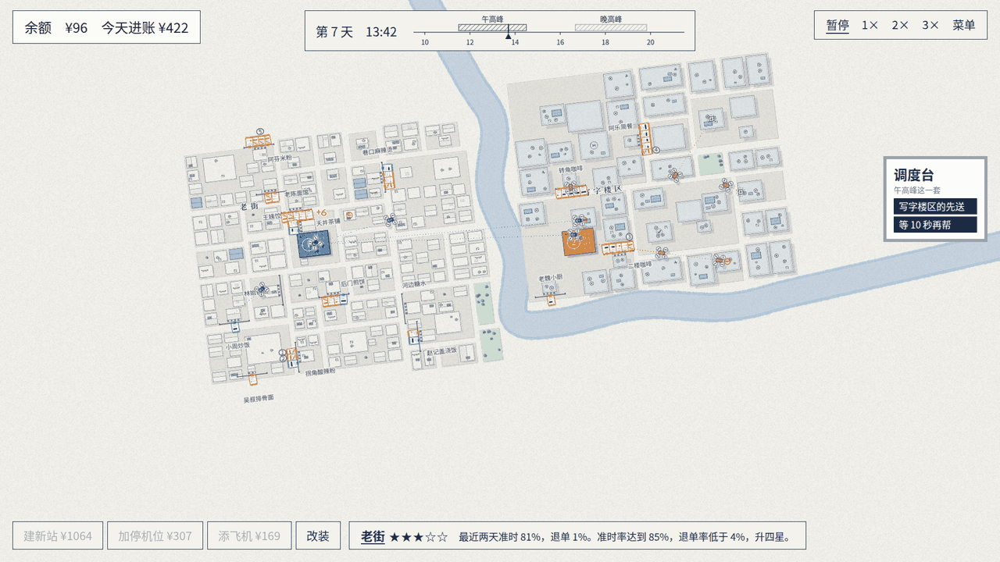

<p align="center"><b>English</b> · <a href="README_zh.md">简体中文</a></p>

# 楼顶外卖站

You run a drone takeout station on the city's rooftops. Mealtimes get busy, and you decide which order goes first.

**Play in the browser: <https://yyyjh1.github.io/sky-delivery/>**

<p align="center">
<a href="https://github.com/YYYJH1/sky-delivery/actions/workflows/pages.yml"></a>
<a href="LICENSE"></a>
</p>

<p align="center"></p>

- Build stations on rooftops and add drones. Orders are sent out on their own.
- There is a rush at lunch and another at dinner. After each rush a receipt shows where the time went.
- Change a rule and see how the next rush goes. You do not need to watch it. Leaving it open is enough.

The city has three districts: Old Street, the Office District and University Town. At first there is only Old Street. Each day ends with a daily receipt. A district is rated on its on-time and cancellation rates over the last two days, and it gains a star when it reaches the next level. A district at three stars or more loses one if it falls short two days running. A district with more stars gets more orders the next day. When a district reaches three stars, the next one appears on the map, and once you pay to open it you can build stations there. When all three districts reach four stars, a closing note shows how many orders you delivered and how many days it took.

The dispatch whiteboard has three columns of rules: which order goes first, how many orders a drone carries on one trip, and whether other stations help out. Each column has a few cards, and more of them open as you play. Once the Office District is open, the lunch rush and the dinner rush can each have their own set.

Space pauses. The keys 1, 2 and 3 change the speed. A right click or Esc backs out one step at a time. You can close the page. When you come back, you get part of what you would have earned while away, based on the last two days and counting at most 30 minutes. The save stays in the browser, and the menu can export it as a line of text to import in another browser.

The game is in Chinese only. It is made for a desktop browser and a window of 1280 × 720 or larger. In a smaller window the page scrolls.

## Run it yourself

You need Node 22.18 or later. In the root of the repository:

```bash
npm ci
npm run dev
```

Vite prints the address to open. `npm test` runs the tests, and `npm run build` builds the web version into `dist/`.

## License

The game is under the MIT License, see [LICENSE](LICENSE). Everything on screen is drawn by code, with [PixiJS](https://pixijs.com) (MIT), [Preact](https://preactjs.com) (MIT) and @preact/signals (MIT). The fonts are subsets of Noto Serif SC, Noto Sans SC, Fusion Pixel Font and Xiaolai, all under the SIL Open Font License 1.1, and [public/fonts/SOURCES.md](public/fonts/SOURCES.md) gives their sources and license texts. [THIRD_PARTY_NOTICES.md](THIRD_PARTY_NOTICES.md) lists every third-party component with its license.
