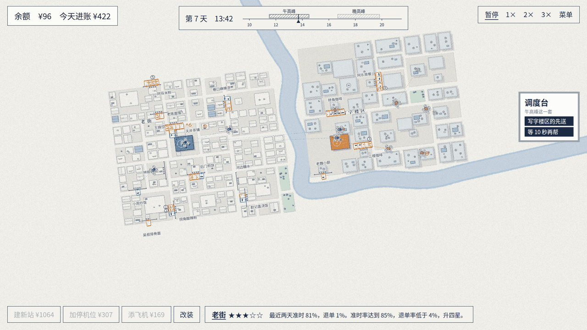

<p align="center"><a href="README.md">English</a> · <b>简体中文</b></p>

# 楼顶外卖站

在楼顶开无人机外卖站。饭点忙起来，先送哪张由你来定。

**在浏览器里玩：<https://yyyjh1.github.io/sky-delivery/>**

<p align="center">
<a href="https://github.com/YYYJH1/sky-delivery/actions/workflows/pages.yml"></a>
<a href="LICENSE"></a>
</p>

<p align="center"></p>

- 在屋顶建站，添飞机。订单会自己派出去。
- 中午和晚上各有一场高峰。高峰过后会出一张小票，写着时间花在了哪里。
- 换一条规矩，下一场高峰再看结果。不用盯着，开着就行。

城里有三个片区：老街、写字楼区和大学城。一开始只有老街。每天结束时有一张日结小票。片区按最近两天的准时率和退单率评星，达到下一档就升一星。三星以上的片区连续两天没守住，会掉一星。星级越高，第二天的订单越多。一个片区到三星以后，下一个片区出现在地图上，花钱开通就能在那里建站。三个片区都到四星时，会出一张结局便签，写着一共送了多少单、用了多少天。

调度台的白板上有三栏规矩：先送哪张单、一趟送几单、别的站帮不帮。每栏有几张卡，玩下去会一张张开放。开通写字楼区以后，午高峰和晚高峰可以各用一套。

空格键暂停。数字键 1、2、3 换速度。右键或 Esc 一层层取消。关掉页面也没关系。下次打开时，按最近两天的进账补上离开期间的一部分，离开的时间最多算 30 分钟。存档放在浏览器里。菜单里可以把存档导出成一段文字，换个浏览器再导入。

游戏里的文字只有中文。画面按电脑浏览器和不小于 1280 × 720 的窗口设计，窗口更小时页面会出现滚动条。

## 自己运行

需要 Node 22.18 或更新的版本。在仓库根目录运行：

```bash
npm ci
npm run dev
```

Vite 会打印要打开的地址。`npm test` 运行测试，`npm run build` 构建网页版，产物在 `dist/`。

## 许可

游戏以 MIT 许可发布，见 [LICENSE](LICENSE)。画面和界面全部由代码绘制，用到了 [PixiJS](https://pixijs.com)（MIT）、[Preact](https://preactjs.com)（MIT）和 @preact/signals（MIT）。字体是思源宋体、思源黑体、缝合像素字体和小赖字体的子集，都以 SIL Open Font License 1.1 发布，来源和许可证全文见 [public/fonts/SOURCES_zh.md](public/fonts/SOURCES_zh.md)。[THIRD_PARTY_NOTICES_zh.md](THIRD_PARTY_NOTICES_zh.md) 列出了全部第三方组件和它们的许可证。
